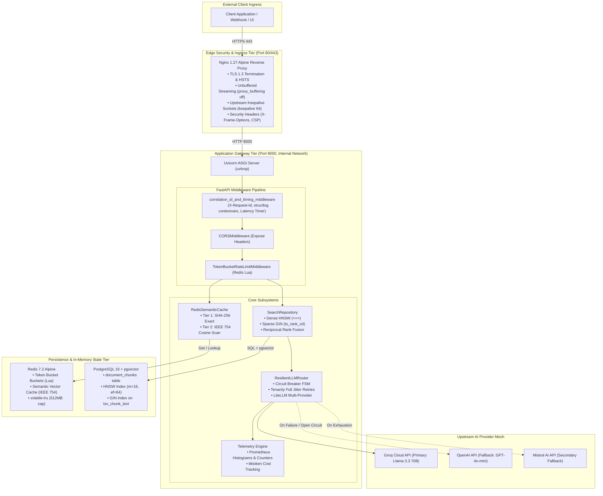

# 02. Architecture & Service Contracts

This document details SentinelRAG's system topology, component boundaries, directional dependency graphs, and cross-service error contracts.

---

## 1. System Topology Overview

SentinelRAG deploys as a multi-tier, containerized architecture partitioned into four distinct trust and operational zones:



---

## 2. In-Depth Component Responsibilities

### 2.1 Edge Reverse Proxy: Nginx 1.27
- **Role:** First contact point for all public ingress traffic.
- **Responsibilities:**
  - Terminates TLS 1.2 and 1.3 with modern ciphers (`ssl_prefer_server_ciphers off`).
  - Enforces `client_max_body_size 50M;` to support large document chunk ingestion payloads.
  - Disables proxy buffering (`proxy_buffering off;`) to allow Server-Sent Events (SSE) and LLM token chunks to stream immediately to end clients without latency buffering.
  - Maintains persistent keepalive connections to the backend (`keepalive 64;`).

### 2.2 Application Server: Uvicorn & FastAPI
- **Role:** High-concurrency asynchronous runtime.
- **Responsibilities:**
  - Runs on `uvloop` (C-based event loop) to handle tens of thousands of concurrent coroutines.
  - Executes non-root as `appuser` (UID 10001) for container escape security.
  - Manages database and cache connection pools across the application lifespan (`@asynccontextmanager`).

### 2.3 Distributed Cache & Rate Limiting: Redis 7.2
- **Role:** Ultra-low-latency state and deduplication store.
- **Responsibilities:**
  - Executes atomic Token Bucket rate limiting via Lua scripting (`EVALSHA`).
  - Stores cached responses under tenant-isolated keys: `cache:{tenant_id}:{hash}`.
  - Stores binary-packed float embeddings for sub-20ms cosine distance gating.
  - Enforces `volatile-lru` eviction with `maxmemory 512mb` to prevent memory exhaustion.

### 2.4 Persistent Database: PostgreSQL 16 + `pgvector`
- **Role:** Single-store relational and hybrid retrieval engine.
- **Responsibilities:**
  - Persists document chunk text, metadata (`JSONB`), and 1536-dimensional float vectors (`vector(1536)`).
  - Maintains automatic full-text search vectors via `tsv_chunk_text TSVECTOR GENERATED ALWAYS AS (to_tsvector('english', chunk_text)) STORED`.
  - Executes nearest-neighbor search via HNSW indexes and lexical keyword search via GIN indexes.

### 2.5 AI Reliability Mesh: LiteLLM, Tenacity & Circuit Breaker
- **Role:** Upstream mediation and resilience.
- **Responsibilities:**
  - Standardizes OpenAI-compatible JSON payloads across heterogeneous providers (Groq, OpenAI, Mistral).
  - Wraps upstream network calls in Tenacity retries with exponential backoff and full jitter.
  - Manages a coroutine-safe Circuit Breaker state machine (`CLOSED`, `OPEN`, `HALF-OPEN`) to prevent cascading thread pool starvation during external outages.

---

## 3. Service Interaction Matrix & Contractual Boundaries

| Origin Service | Target Service | Protocol / Transport | Payload Format | Failure Behavior |
|---|---|---|---|---|
| **Nginx** | **FastAPI** | HTTP/1.1 (Docker Bridge) | JSON / HTTP Stream | Retries next upstream; returns 502 if all fail. |
| **FastAPI Ingress** | **Redis (Limiter)** | Redis RESP (TCP Socket) | Lua Script Parameters | **Fails Open:** Allows request through if Redis is offline. |
| **FastAPI Ingress** | **Redis (Cache)** | Redis RESP (TCP Socket) | SHA-256 Key & IEEE 754 Bytes | **Fails Open:** Bypasses cache and proceeds to DB retrieval. |
| **FastAPI Repo** | **PostgreSQL** | Postgres Binary Protocol | Parameterized SQL | Raises 500 / ProblemDetailException; rolls back session. |
| **FastAPI Router** | **LiteLLM / Groq**| HTTPS (REST API) | OpenAI ChatCompletion JSON | Retries 3x; trips Circuit Breaker; fails over to OpenAI. |
| **FastAPI Router** | **LiteLLM / OpenAI**| HTTPS (REST API) | OpenAI ChatCompletion JSON | Fallback execution; raises 503 if secondary also fails. |

---

## 4. Exception Propagation Hierarchy (RFC 7807)

SentinelRAG enforces the IETF **RFC 7807 Problem Details** specification. All errors returned to clients have `Content-Type: application/problem+json` and follow a strict, standardized schema:

```json
{
  "type": "https://api.sentinelrag.com/errors/rate-limit-exceeded",
  "title": "Too Many Requests",
  "status": 429,
  "detail": "Rate limit quota exceeded. Refill in 5 seconds.",
  "instance": "/api/v1/chat/completions",
  "request_id": "req_a1b2c3d4e5f6"
}
```

### Exception Class Hierarchy
```
Exception
  └── ProblemDetailException (app/core/exceptions.py)
        ├── RateLimitExceededException (HTTP 429)
        │     Headers: Retry-After, X-RateLimit-Remaining
        ├── CircuitBreakerOpenException (HTTP 503)
        │     Headers: Retry-After, X-Circuit-Breaker-State
        ├── AuthenticationFailedException (HTTP 401)
        ├── ValidationFailedException (HTTP 422)
        └── UpstreamProviderOutageException (HTTP 502)
```

**Key Architectural Rule:** Internal stack traces, raw database error strings, and third-party API keys are **never** exposed in HTTP responses. They are masked by the exception handler in `app/main.py` and logged privately to `structlog` with the associated `request_id`.

---

## 5. Dependency Architecture & Acyclic Import Graph

To prevent circular dependencies and race conditions during application startup, SentinelRAG maintains a strict, acyclic layered architecture:

```
[ Tier 1: Core Utilities ]
  app/core/config.py, logging.py, exceptions.py, database.py, redis.py
        │
        ▼
[ Tier 2: Domain Models & Repositories ]
  app/models/document.py, app/db/session.py, app/repositories/search.py
        │
        ▼
[ Tier 3: Domain Services ]
  app/services/cache.py, rrf.py, router.py, resilience.py, token_analytics.py
        │
        ▼
[ Tier 4: API Controllers & Middleware ]
  app/core/rate_limiter.py, app/api/v1/*.py
        │
        ▼
[ Tier 5: Application Entrypoint ]
  app/main.py
```

**Architectural Invariant:** Modules in lower tiers may never import modules from higher tiers. For example, `app/services/cache.py` (Tier 3) never imports routes from `app/api/v1/` (Tier 4). Dependency injection is handled at the controller layer via FastAPI `Depends()`.
